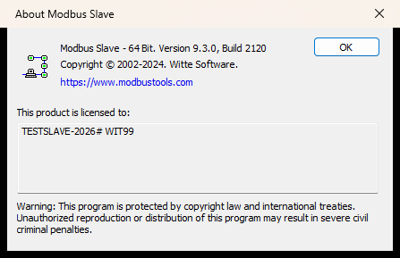

# Modbus Slave 9.x 注册码生成器 / Keygen

[-2f6f4f)](docs/registration_logic.md)
[](#)
[](#-实机验证)

针对 **Witte Software Modbus Slave 9.3.0.2120 (x64)** 的注册码逆向与生成工具。
算法由静态反汇编还原，生成器在真机上验证通过：About 显示授权名、Connect 可用、30 天到期提示与 10 分钟断连限制全部解除。

> **免责声明**：本项目仅用于逆向工程学习、软件兼容性研究与自有软件资产维护。请在合法授权的环境中使用，因使用产生的后果由使用者自行承担。



---

## 目录

- [特性](#-特性)
- [快速开始](#-快速开始)
- [算法](#-算法)
- [逆向要点](#-逆向要点)
- [实机验证](#-实机验证)
- [注意事项](#-注意事项)
- [回滚与恢复试用](#-回滚与恢复试用)
- [仓库结构](#-仓库结构)
- [English](#english)

---

## ✨ 特性

| | |
|---|---|
| **GUI 注册机** | `release/ModbusSlave-Keygen.hta`，双击运行（系统自带 mshta，零依赖），可一键写入注册表 |
| **命令行生成器** | `keygen/keygen.vbs`（Windows 内置 cscript）、`keygen/keygen.py`（Python 3.8+） |
| **自校验** | `keygen/selfcheck.py`：独立实现的 App 端校验模型 + 200 组随机往返 + 已知答案 + 负例，`PASS` 才可信 |
| **完整逆向证据** | `docs/registration_logic.md` + `docs/asm/` 下 19 份函数级反汇编，每个结论都带 VA |
| **真机验证记录** | `docs/verify.md`：授权生效、冷启动 3/3、Connect 无弹窗、570 s 无 10 分钟断连 |

支持任意注册名（4–40 个可打印 ASCII 字符，不能含 `WIT`），支持 WIT 编号 23–99。

## 🚀 快速开始

### 方式 1：GUI（推荐）

1. 双击 `release/ModbusSlave-Keygen.hta`
2. 填 **注册名**（会显示在 `Help → About`），WIT 编号保持 `99`
3. **生成注册码** → **写入本机并生效**
4. 关闭并重新打开 Modbus Slave（授权只在启动时读一次）

写入位置：`HKCU\Software\Witte Software\mbslave\Register`（`Key` + `Name`，均为 REG_SZ）。

### 方式 2：命令行

```bat
:: Windows
cscript //nologo keygen\keygen.vbs "MY-NAME-2026" 99
```

```bash
# Linux / macOS / WSL
python3 keygen/keygen.py "MY-NAME-2026" 99
python3 keygen/keygen.py --json "MY-NAME-2026" 99
python3 keygen/selfcheck.py      # 退出码 0 = 全部通过
```

输出的注册码粘到 `Help → Register` 对话框，**Register name 必须与生成时完全一致**。

### 方式 3：导入现成授权

```bat
reg import release\license-TESTSLAVE-2026.reg
```

## 🧮 算法

```
keystream = "97280132"          # 常量 0x01C59D0D = 十进制 29728013，十进制字符串左移一位循环
plaintext = "mbslave" + name + "\n" + "# WIT99"
cipher[i] = plaintext[i] XOR keystream[i % 8]
key       = cipher 的大写十六进制 + 末 2 位（= 全部明文字节 XOR）
```

以 `name = "TESTSLAVE-2026"`、WIT99 为例：

```
明文       mbslaveTESTSLAVE-2026\n# WIT99
密钥串     97280132
注册码     54554154514756667C64666B7C7065771405020A063B10126E7E66010951
```

## 🔬 逆向要点

| 环节 | 地址 (VA) | 说明 |
|---|---|---|
| XOR 常量 | `0x1400572FF` | `mov ecx,0x1c59d0d`，全文件唯一 |
| 校验器 | `0x140058570` | 去 `\n\r` → hex 解码 → 循环 XOR → 校验字节 → 前缀 `mbslave` |
| 判定函数 | `0x140057030` | 返回码 `0` 非法 / `4` v4 旧码 / `5` v5–8 旧码 / **`6` 通过** |
| 版本闸门 | `0x1400573F8` | 解密串中 `WIT` 后两位 ∈ **14..22** → 拒绝（9.x 新增），其余通过 |
| 启动加载 | `0x140058290` | 读 HKCU（失败再读 HKLM）→ `byte[0x140257490] = 1` |
| 到期降级 | `0x140058F80` / `0x140057610` | 30 天提示、端口参数降级 100、10 分钟断连，均以 `licensed == 0` 为条件 |

三个必须踩对的细节：

1. **大写十六进制** —— `hexval(0x140051C40)` 只认 `0-9`/`A-F`，小写字母静默当 0；
2. **WIT 编号只能 23–99** —— 14–22 会被判成 "version 5 - 8" 旧码；
3. **注册名不能含 `WIT`** —— 程序取解密串里第一个 `WIT` 的后两位当版本号。

## ✅ 实机验证

测试环境：Windows 10 x64，`C:\Program Files\Modbus Tools\Modbus Slave\mbslave.exe` 9.3.0.2120。

| 项目 | 结果 |
|---|---|
| 注册码被接受 | About 显示 `This product is licensed to: TESTSLAVE-2026` |
| 冷启动稳定性 | 3/3 次启动均读到授权名 |
| Connect 可用 | `F5` 后无未注册/过期弹窗，`LISTEN 0.0.0.0:502` |
| 10 分钟断连 | 570 s 连续连接、19 次采样，无 "10 minutes trial period" 弹窗，进程存活 |
| 反盗版暗桩 | 未发现 Modbus Poll 式"注册后数据不刷新"标志 |

详细证据与时间戳见 [docs/verify.md](docs/verify.md)。

## ⚠️ 注意事项

- 授权只在程序启动时读取，**换码/换名后要关掉重开**。
- 32/64 位注册表视图：程序是 x64，写 `HKCU\Software\...`（不是 `WOW6432Node`）。
- About 里授权名会显示两行（`名字` + `# WIT99`），因为授权文本就是解密串去掉 `mbslave` 前缀，属正常现象。
- 同一套密钥常量也被 Modbus Poll 使用，本项目只覆盖 Modbus Slave。

## ↩️ 回滚与恢复试用

```bat
:: 取消注册
reg delete "HKCU\Software\Witte Software\mbslave\Register" /f

:: 重置 30 天试用（删除试用锚点）
reg delete "HKCU\Software\Nogle\bbb1" /f
```

原始备份（安装初始态）：`backup-mbslave.reg`。

## 📁 仓库结构

```
.
├── keygen/
│   ├── keygen.py          # Python 参考实现（含 verify_key 复刻 App 校验）
│   ├── keygen.vbs         # VBScript 实现（Windows 内置引擎）
│   ├── selfcheck.py       # 自校验：独立模型 + 200 随机往返 + 已知答案 + 负例
│   ├── keys.json          # 5 组示例注册码
│   └── README.md          # 生成器细节
├── release/
│   ├── ModbusSlave-Keygen.hta          # GUI 注册机
│   └── license-TESTSLAVE-2026.reg      # 实测生效的授权
└── docs/
    ├── registration_logic.md           # 逆向报告（结论表 + 地址 + 伪代码）
    ├── verify.md                       # 真机验证记录
    ├── asm/                            # 19 份函数级反汇编
    └── img/                            # 验证截图
```

## English

A registration-key generator for **Witte Software Modbus Slave 9.3.0.2120 (x64)**, reconstructed from
static disassembly (`docs/registration_logic.md` documents every claim with a VA).

```
keystream = "97280132"        # 0x01C59D0D = 29728013 (decimal), rotated left by one digit
plaintext = "mbslave" + name + "\n" + "# WIT99"
key       = uppercase hex of (plaintext XOR keystream, cyclic) + 2-hex-digit XOR checksum
```

- The key must be **uppercase hex** — the parser silently treats `a-f` as `0`.
- WIT numbers **14–22 are rejected** as "version 5 - 8" legacy keys; use 23–99.
- The name must not contain `WIT` (it is parsed as the version marker).
- Registration lives in `HKCU\Software\Witte Software\mbslave\Register` (`Key`, `Name`, REG_SZ) and is
  read once at startup; restart the app after writing.

Usage: run `release/ModbusSlave-Keygen.hta`, or `cscript keygen\keygen.vbs "NAME" 99`, or
`python3 keygen/keygen.py "NAME" 99`. Run `python3 keygen/selfcheck.py` for the self-test.

Verified on a real Windows 10 host: license accepted, 3/3 cold starts, `Connect` works with no expiry
dialog, no 10-minute disconnect during a 570 s session. See `docs/verify.md`.

*For research and interoperability purposes only.*
